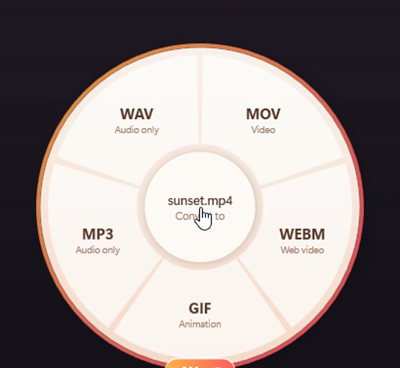
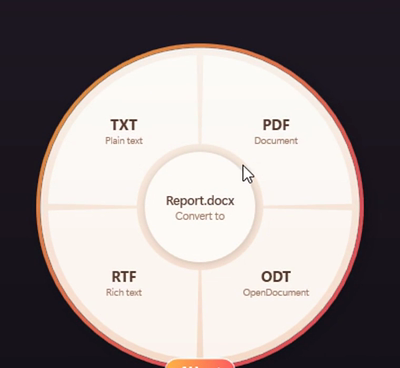
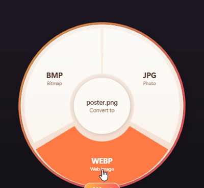

# Drop Convert

Convert files without opening them. Drop a file on a small orange bubble, pick a format from the
round menu, and the converted copy is saved next to the original.

  
  
  

Full demo video: [docs/demo.mp4](docs/demo.mp4)

## What it does

- A floating bubble that stays on top. Drag it anywhere; it remembers the spot.
- Drop one file or many. The round menu only shows formats that fit the file.
- Point at the orange ring (or the **ALL** tab) to get every format at once.
- The original is never changed, and nothing is overwritten (`clip (2).mp4`).
- Files are converted on your own computer and never uploaded. There is no account.

| You drop | You can get |
|---|---|
| Video: MP4, MOV, MKV, AVI, WEBM, M4V, WMV, FLV | MP4, MOV, WEBM, GIF, MP3, WAV |
| GIF | MP4, MOV, WEBM |
| Audio: MP3, WAV, FLAC, M4A, OGG, AAC, OPUS, WMA | MP3, WAV, FLAC, M4A, OGG |
| Image: PNG, JPG, WEBP, BMP, TIFF | PNG, JPG, WEBP, BMP |
| Document: DOCX, DOC, RTF, ODT, TXT | PDF, DOCX, ODT, RTF, TXT |
| PDF | DOCX, TXT, or one JPG / PNG per page |

## Install

### Windows 10 / 11

1. Download **drop-convert-windows.zip** from [Releases](../../releases) and unzip it.
2. Double-click **Install Drop Convert.cmd**. It builds the app from source with the C# compiler
   that comes with Windows (no .exe is downloaded) and adds Desktop and Start menu shortcuts.
   It offers to install free ffmpeg with winget if you don't have it.
3. Open **Drop Convert** from the Desktop or Start menu.

Needs: [ffmpeg](https://ffmpeg.org) for video, audio and images (free), and Microsoft Word 2016 or
newer for documents and PDF to Word. Without one of them, those formats show **Failed**; the rest
still work.

More in [windows/README.md](windows/README.md).

### Mac (untested)

The Mac version is written in Swift and builds on your Mac with Apple's free Command Line Tools.
**It has not been run on a real Mac yet.** Download **drop-convert-mac.zip** from
[Releases](../../releases) and follow [mac/README.md](mac/README.md). Bug reports are welcome.

## Build it yourself

Windows: the whole app is one file, [windows/DropConvert.cs](windows/DropConvert.cs).
Run [windows/build.cmd](windows/build.cmd) to make DropConvert.exe. Nothing to install.

Mac: [mac/DropConvert.swift](mac/DropConvert.swift), built by the installer with `swiftc`.

## How it was made

Made with AI. I described the app in plain words and Claude Code wrote the code, the installers and
the demo. I decided what the app should do. Every format was tested on Windows; the Mac version
has not been run yet.

## License

[MIT](LICENSE)
